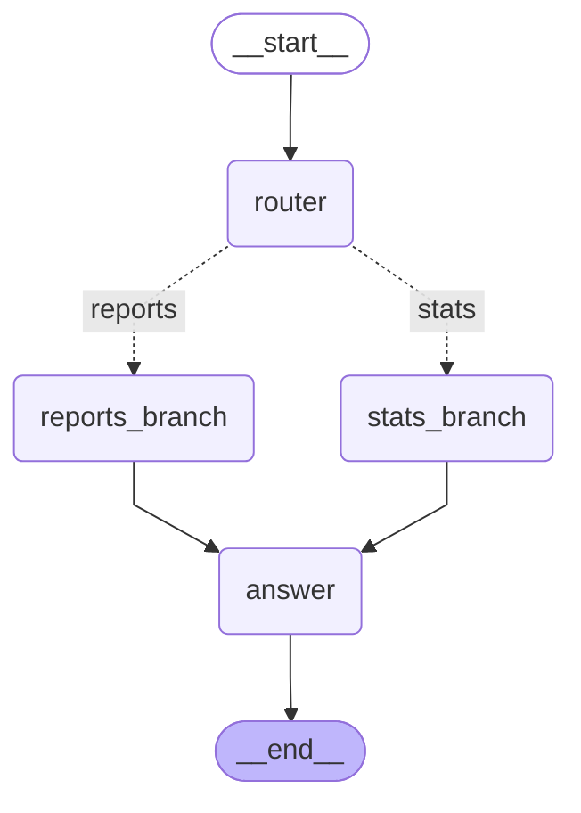

# player_undervaluation_model
A data-driven football model for identifying players whose performance and development profile may be undervalued relative to market value.

# Research question:
Using only pre transfer data, can a model identify players moving from nine European leagues outside the top five to top five league clubs who become regular starters within two seasons, and were such players undervalued by the market at the time of transfer?

## Scope
Phase 1: Belgium, Netherlands, Portugal, Turkey, Scotland, Denmark, Greece,
Russia, Ukraine to England, Spain, Italy, Germany, France. All positions.
Phase 2: add South America (needs historical data not in the current dataset).

## Data
Built on [transfermarkt-datasets](https://github.com/dcaribou/transfermarkt-datasets)
by dcaribou (CC0 1.0), sourced from Transfermarkt. Snapshot: 2026-07-06.
Raw data is not included in this repo; see docs/data_sources.md to download.

## Pre transfer models (Step 2): status, working, run on 2026-10-15

Data is loaded into PostgreSQL (`tm_raw` schema, text columns) and cleaned in SQL (`sql/01_build_pre_transfer.sql`). Every feature uses only data dated before the transfer date. The label uses the two years after it.

**Real record count: 1,669 pre transfer records.** The resume says 3500+. The count is below that and is reported as measured (logged in the discrepancy file kept with the project notes). The rules below were fixed before any count or model result was seen, and they were not widened to reach a target.

| Step | Rule | Rows |
|---|---|---|
| 1 | rows in the Transfermarkt transfers table | 175,165 |
| 2 | dated on or before the snapshot (2026-07-06) | 174,645 |
| 3 | dated 2013-06-01 to 2024-09-30, so the two year label window is complete | 133,276 |
| 4 | from club played in one of the 9 source leagues at the time | 13,519 |
| 5 | and the to club played in a top five league | 1,725 |
| 6 | after dropping same club moves and duplicates | 1,725 |
| 7 | at least one appearance in the 365 days before the move | **1,669** |

The earlier rough estimate of about 2,896 movers (in `STATE.md`) used each club's current league and no date window, so it counted moves that were not from a source league to a top five league at the time. The league at the time of each move comes from the games actually played, which is the stricter and correct way.

**Label:** `regular_starter` is 1 if, in year 1 or year 2 after the move, the player played at least 50% of the possible league minutes of the new club (league games, at the new club). 29.6% of records are regular starters.

**Split by transfer date.** Train: moves up to 2020-06-30 (694). Validation: 2022-07-01 to 2023-06-30 (246). Test: 2023-07-01 to 2024-09-30 (333). Moves from 2020-07 to 2022-06 (396) are an embargo and are not used, because their two year label windows would run into the validation period. Hyperparameters were chosen on validation ROC AUC only.

### Results (test set, 333 moves, 30.9% regular starters, run 2026-10-15)

| Model | Precision | Recall | ROC AUC | AUC 95% interval |
|---|---|---|---|---|
| Baseline: constant prior | 0.309 | 1.000 | 0.500 | n/a |
| Baseline: minutes played in last 365 days | 0.398 | 0.816 | 0.706 | 0.646 to 0.764 |
| Logistic regression (scikit-learn) | 0.469 | 0.670 | 0.737 | 0.679 to 0.794 |
| Gradient boosting (scikit-learn) | 0.490 | 0.718 | 0.745 | 0.686 to 0.798 |
| MLP (PyTorch) | 0.462 | 0.757 | 0.740 | 0.682 to 0.796 |

Precision and recall use one threshold per model, picked on validation by best F1. All three learned models beat the constant baseline clearly. Their gain over the simple minutes rule is small (about 0.03 to 0.04 AUC) and the intervals overlap, so the models are not clearly better than each other or, with this test size, than the minutes rule. The PyTorch MLP scored best on validation (0.764) so it is the model used for the shortlist. Details: `notebooks/02_models.ipynb`, `results/step2_results.md`, `results/step2_model_results.csv`.

### Shortlist: 100 names per league

`python -m src.shortlist` writes `results/shortlists/shortlist_<league>.csv` for each of the nine source leagues. The rule:

1. Eligible: currently at a club in the league, at least 450 minutes in the 365 days before 2026-07-06, a market value on record, age 30 or under.
2. p is the model's predicted probability of becoming a regular starter after a move, averaged over the five top league destinations.
3. score is the percentile rank of p within the league minus the percentile rank of market value within the league.
4. Output the 100 highest scores.

This cuts a league of 170 to 300 eligible players to 100. A backtest on the test moves shows the top 20% by predicted probability became regular starters 56.7% of the time (base rate 30.9%). The top 20% by shortlist score, which also rewards low market value, did so 49.3% of the time. So the value part of the rule trades some success rate for cheaper players. Whether the listed players were really undervalued is not proven by this data, because market value is Transfermarkt's own estimate and fees are not used.

### Limitations

* 1,669 records is a small sample, and the test interval on ROC AUC is about plus or minus 0.06.
* The model has no destination club strength, no team quality and no advanced stats (only appearances, minutes, goals, assists, cards, market value history and basic player facts).
* There is no loan flag in the data, so loan moves may be included.
* The first version of the shortlist had no age rule and listed mostly 33 to 38 year olds. The age cap of 30 (95th percentile of real movers) was added after seeing that output. It is noted in the decision log.
* The shortlist leans towards defenders, because defenders became regular starters more often in the training data (38%, against 21% for attackers).
* Market value is Transfermarkt's crowd estimate, so the undervaluation question is only answered relative to it.

### Reproduce

```bash
python -m venv .venv && source .venv/bin/activate && pip install -r requirements.txt
cp .env.example .env                       # set DATABASE_URL, needs PostgreSQL 14 or newer
# place the 2026-07-06 snapshot CSVs in data/raw/transfermarkt/2026_07_06/
python -m src.load_postgres
psql "$DATABASE_URL" -f sql/01_build_pre_transfer.sql
psql "$DATABASE_URL" -f sql/02_shortlist_features.sql
jupyter nbconvert --to notebook --execute notebooks/02_models.ipynb --output 02_models.ipynb
python -m src.shortlist
python -m pytest tests
```

## RAG scouting assistant (Step 3): built and benchmarked 2026-10-15

> Status: working end to end. The index holds 8,177 player season profiles and 7 notes (sentence transformers `all-MiniLM-L6-v2` into pgvector). The 20 question benchmark was run with Claude Sonnet 5.5: **10 of 10 on the tune questions and 9 of 10 (90%) on the 10 held out questions**, citations 17 of 17 valid on each set. Details, per question answers and the prompt hash are in `eval/results.md` and `eval/runs.jsonl`.

### What it does
A question answering assistant over player season records from nine leagues outside the top five (2022/23 to 2025/26, 900 or more league minutes). Every answer cites the player and season it used. If the records do not support an answer, it replies "not enough data" and says what is missing.

### Data source
The assistant reads the Transfermarkt snapshot already in PostgreSQL: appearances, minutes, goals, assists, cards, age, position and market value, 8,177 player seasons. It has no xG, passes, tackles or pressing, because FBref advanced stats were removed in January 2026 (see `docs/data_sources.md`). The prompts tell the model this, and questions about missing stats are expected to get "not enough data".

### Architecture (LangGraph)

The graph below is generated from `rag/graph.py` by `python -m rag.graph --diagram`. A test fails if this block and the code disagree.

<!-- graph:start -->

<!-- graph:end -->

* **router**: the model picks `stats` or `reports` with LangChain structured output.
* **stats_branch**: the model fills a fixed query schema (league, season, position, age range, order by, limit, player names, unsupported metric flag). Code checks the schema against whitelists and builds a parameterised SQL query. The model never writes SQL. Unsupported metrics, leagues and seasons are refused here before any answering.
* **reports_branch**: semantic search (sentence transformers into pgvector) over the scouting notes in `notes/scouting_notes/`.
* **answer**: the model answers only from the retrieved records, with [Player, Season] or [Note: title] citations. With no records it returns "not enough data" without calling the model.

The 7 notes are **data derived drafts** generated by `notes/generate_draft_notes.py` from the same table, not eyewitness scouting. Replace or add your own notes in the same folder; any `.md` file with the same front matter is indexed.

### Prompt engineering decisions
* Structured output for the router and the filter extractor, so the model fills a schema instead of writing free text or SQL.
* Both prompts list what the data does not contain, with examples, so refusals happen early.
* Deterministic guards after the model: league, season and sort column are checked in code.
* The answer prompt forbids outside knowledge, fixes the refusal phrase and the citation format.
* The 20 questions are split 10 and 10. Prompts are tuned only on the 10 tune questions. The 10 held out questions are run once on frozen prompts. Each run logs a hash of `rag/prompts.py` in `eval/runs.jsonl`.

### Layout

| Path | Purpose | Status |
|---|---|---|
| `sql/03_player_seasons.sql` | Player season table from the Transfermarkt snapshot | Working, 8,177 rows |
| `rag/ingest.py` | Build that table and log provenance | Working |
| `rag/documents.py` | Player season row to text profile plus metadata | Working, tested |
| `rag/build_index.py` | Embed profiles and notes into pgvector | Working, run 2026-10-15 |
| `rag/store.py` | Whitelisted SQL and pgvector search | Working, tested |
| `rag/graph.py` | LangGraph router, branches, answer | Working, tested with a fake model |
| `rag/prompts.py` | Router, filter and answer prompts | Written |
| `rag/chain.py`, `rag/cli.py` | Real model entry point and terminal command | Working |
| `notes/scouting_notes/` | 7 draft notes from repo data | Working |
| `eval/benchmark.json` | 20 questions with saved SQL and SQL results | Built |
| `eval/run_eval.py` | Scoring and results rendering | Working, run on the real model |
| `eval/results.md` | Dated results | Generated by the runner |

### Results (2026-10-15)

| Split | Questions | Answer accuracy | Citation accuracy | Not enough data correct |
|---|---|---|---|---|
| Tune (prompts were tuned on these) | 10 | 10/10 | 17/17 | 3/3 |
| **Held out (run once, prompts frozen, hash abdfc0dada)** | 10 | **9/10 (90%)** | 17/17 | 2/2 |

* Ten held out questions is a small sample: one question is 10 points, and the 95% interval for 9 of 10 is about 60% to 98%.
* The one held out miss, h05 ("which of the nine leagues had the oldest average player age"), was answered "GR1 had the oldest average player age, at 28.0" with a correct citation. That is the right league and the right number, but the strict scorer expects the league name "Greek Super League", so it counts as wrong. I did not change the scorer after seeing the held out result.
* Changes made while tuning, all on the tune set only: season totals (goals, assists, cards) were added to every profile after "how many goals" questions returned "not enough data"; the note citation scorer was fixed after it split the note title "Belgian Pro League attackers, 2025/26" at the season. The first tune run (before the scorer fix) is not kept in the log.
* The model setting `temperature` is not accepted for this model name, so runs are not forced to temperature 0 and a rerun can differ slightly.
* One command: `python -m rag.cli "Which 3 defenders aged 21 or under played the most minutes in Liga Portugal in 2025/26?"` returns three players with [Player, Season] citations.

### Run it

```bash
cp .env.example .env                 # add ANTHROPIC_API_KEY, set EMBEDDING_MODEL to the model folder
python -m rag.ingest
python -m rag.build_index
python -m rag.cli "Which 3 defenders aged 21 or under played the most minutes in Liga Portugal in 2025/26?"
python -m eval.run_eval --split tune
python -m eval.run_eval --split heldout
```

### Limitations
* Only goals, assists, minutes, cards and market value are available per player, so most scouting style questions get "not enough data".
* The router and the filter extractor can still misread a question. The benchmark will show how often.
* The notes are generated from data, so the reports branch only knows what those tables say.

### Latest eval results

| Date | Profiles indexed | Answer accuracy | Citation accuracy | "Not enough data" correct |
|---|---|---|---|---|
| 2026-10-15 (held out, 10 questions) | 8,177 | 9/10 (90%) | 17/17 | 2/2 |
| 2026-10-15 (tune, 10 questions) | 8,177 | 10/10 | 17/17 | 3/3 |

## Computer vision on past player actions (Step 4): built and measured 2026-10-15

Event data: [StatsBomb open data](https://github.com/statsbomb/open-data) (World Cup 2022, Euro 2024, Africa Cup of Nations 2023, Copa America 2024). Credit: StatsBomb. These are **national team tournament matches, not league games**, because the free StatsBomb data has no match events for the nine source leagues.

What it does: renders pass, carry and shot maps for each player (mplsoccer), has a vision capable model (Claude Sonnet 5.5) describe each image and tag it from fixed lists, stores the descriptions in the pgvector index as extra documents linked to the player and season, and lets the assistant cite them as `[Vision: Player, Season]`.

| Step | File | Output |
|---|---|---|
| Link tournament players to league players | `rag/vision/link_players.py` | `results/vision/player_links.csv`: 215 players linked (name match of 92 or more AND same nationality); the 2024 entries are one season per tournament |
| Extract actions | `rag/vision/extract_actions.py` | 37,945 passes, carries and shots (data/interim, not committed) |
| Rule based truth | `rag/vision/summarise.py` | `results/vision/action_summary.csv` with numbers and tags (thresholds fixed before any comparison) |
| Images | `rag/vision/render.py` | 164 images in `figures/vision/` (players with 40 or more passes or 3 or more shots) |
| Vision descriptions | `rag/vision/describe.py` | `results/vision/descriptions.jsonl`, 162 of 164 images (2 failed structured output validation twice and are left out) |
| Index | `rag/vision/index_vision.py` | 162 documents in pgvector, plus `tm.vision_truth` |
| Check | `rag/vision/check_tags.py` | `results/vision/tag_agreement.md` |

### Do the vision tags match the event data?

| Tag | Vision model agrees with event data | Always guessing the most common tag |
|---|---|---|
| Passing territory | 66% | 41% |
| Pass direction | 49% | 43% |
| Pass length | 73% | 62% |
| Carries into final third | 72% | 86% |
| Shooting distance | 67% | 46% |

Passing territory and shooting distance are clearly better than guessing. Pass direction is barely better, and the carries tag is **worse** than always answering "few carries". The descriptions are therefore weak evidence, and every vision document says "Vision derived, may be inaccurate".

### Does it help the assistant? (eval/results.md, run 2026-10-15)

| Question set | Without vision documents | With vision documents |
|---|---|---|
| Original 20 questions | 19/20 | 19/20 |
| 8 vision questions (answers from the event data tags) | 0/8 | 4/8 |

* **On the original 20 questions the vision documents did not help.** Those questions are about league season numbers and the vision documents hold nothing about them. Both conditions miss the same question (h05, a strict scoring miss explained above).
* On the 8 questions that can only be answered from the maps, the assistant correctly says "not enough data" without the documents (counted wrong, because the expected answer is a choice), and gets 4 of 8 right with them. That is about the accuracy of the vision tags, with 2 to 3 answer options per question, so it is only modestly above guessing. Eight questions is a very small sample.
* The 8 players were picked at random (seed 7) before any run. Prompts were updated once to describe the vision documents, so these runs used a newer prompt hash than the 2026-10-15 held out result, and they are not a clean held out measurement.

### Limitations
* Tournament matches are a different setting from league football, and a player has 1 to 7 matches in the sample.
* Only 215 of 8,177 league players in the index have a linked tournament record.
* The vision model reads small images and its tags are often wrong in the ways shown above. Do not treat the descriptions as scouting facts.

Run order: `python -m rag.build_index` first (it rebuilds the index table), then `python -m rag.vision.link_players`, `extract_actions`, `summarise`, `render`, `describe`, `index_vision`, `check_tags`, and `python -m eval.build_benchmark` (adds the 8 vision questions), then `python -m eval.run_eval --split vision` and `--split vision --no-vision`.


## Run the assistant in Docker (Step 5, part 1): written 2026-10-15

The assistant ships as a small web service (`app/server.py`) with a one page demo, packaged with Docker Compose: one container for Postgres with pgvector, one for the app.

```bash
cp .env.example .env        # then put your ANTHROPIC_API_KEY in .env
docker compose up --build   # first build takes several minutes (torch, embedding model)
# open http://localhost:8000
```

How it works:
* `deploy/demo_db.sql.gz` (11 MB) holds the two tables the assistant reads, `rag.documents` (8,346 documents with embeddings) and `tm.player_season_stats` (8,177 rows). Postgres loads it on first start, so the demo needs no Transfermarkt files and no rebuild of the index. The source data is CC0.
* The embedding model is downloaded once while the image is built and stored inside the image, so the running container never needs Hugging Face.
* The database port is not published. Only the app container can reach it.
* The API key is read from your shell or `.env` and is never baked into the image or committed. `.dockerignore` keeps `.env` out of the build.
* Three limits protect the API credit: 300 characters per question, 15 questions per IP per day, 200 per day for the whole service (`DAILY_LIMIT_PER_IP`, `DAILY_LIMIT_TOTAL`). Counters live in memory and reset when the container restarts.
* `GET /health` checks the database. `POST /ask` takes `{"question": "..."}` and returns the answer with its sources.

Tests: `tests/test_server.py` covers the limits and the response shape with the model call stubbed out. The service was also run against the real index and API with `uvicorn app.server:app` on 2026-10-15, answering the stats questions with citations.

Status: built and run with `docker compose up --build` on an Apple Silicon Mac (Docker 29.8.2) on 2026-10-15. Both containers reported healthy, `/health` returned 8,346 documents, and the demo page answered a question with a source tag. Docker was not available in the environment where the files were written, so this first build was done by the author on a laptop. Deployed to a small AWS server on 2026-10-16, see `docs/deploy_aws.md` (plain HTTP on a bare IP, runs on free plan credits for about 6 months).

Known limitation found while testing: the records label leagues by code ("NL1"), so a question that says only "Eredivisie" can return a cautious answer that says the records never name the league. Adding the code to the question ("Eredivisie (NL1)") works. The prompts and index were frozen for the benchmark, so this was not changed. The page examples use the code form.
