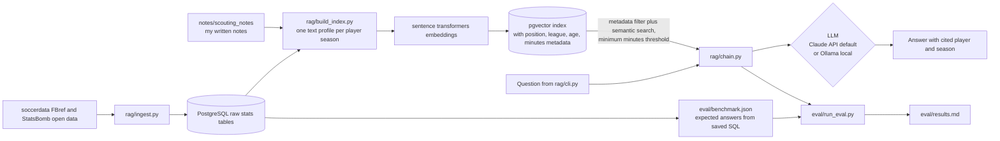

# player_undervaluation_model
A data-driven football model for identifying players whose performance and development profile may be undervalued relative to market value.

# Research question:
Using only pre transfer data, can a model identify players moving from nine European leagues outside the top five to top five league clubs who become regular starters within two seasons, and were such players undervalued by the market at the time of transfer?

## Scope
Phase 1: Belgium, Netherlands, Portugal, Turkey, Scotland, Denmark, Greece,
Russia, Ukraine to England, Spain, Italy, Germany, France. All positions.
Phase 2: add South America (needs historical data not in the current dataset).

## Data
Built on [transfermarkt-datasets](https://github.com/dcaribou/transfermarkt-datasets)
by dcaribou (CC0 1.0), sourced from Transfermarkt. Snapshot: 2026-07-06.
Raw data is not included in this repo; see docs/data_sources.md to download.

## Pre transfer models (Step 2): status, working, run on 2026-10-15

Data is loaded into PostgreSQL (`tm_raw` schema, text columns) and cleaned in SQL (`sql/01_build_pre_transfer.sql`). Every feature uses only data dated before the transfer date. The label uses the two years after it.

**Real record count: 1,669 pre transfer records.** The resume says 3500+. The count is below that and is reported as measured (logged in the discrepancy file kept with the project notes). The rules below were fixed before any count or model result was seen, and they were not widened to reach a target.

| Step | Rule | Rows |
|---|---|---|
| 1 | rows in the Transfermarkt transfers table | 175,165 |
| 2 | dated on or before the snapshot (2026-07-06) | 174,645 |
| 3 | dated 2013-06-01 to 2024-09-30, so the two year label window is complete | 133,276 |
| 4 | from club played in one of the 9 source leagues at the time | 13,519 |
| 5 | and the to club played in a top five league | 1,725 |
| 6 | after dropping same club moves and duplicates | 1,725 |
| 7 | at least one appearance in the 365 days before the move | **1,669** |

The earlier rough estimate of about 2,896 movers (in `STATE.md`) used each club's current league and no date window, so it counted moves that were not from a source league to a top five league at the time. The league at the time of each move comes from the games actually played, which is the stricter and correct way.

**Label:** `regular_starter` is 1 if, in year 1 or year 2 after the move, the player played at least 50% of the possible league minutes of the new club (league games, at the new club). 29.6% of records are regular starters.

**Split by transfer date.** Train: moves up to 2020-06-30 (694). Validation: 2022-07-01 to 2023-06-30 (246). Test: 2023-07-01 to 2024-09-30 (333). Moves from 2020-07 to 2022-06 (396) are an embargo and are not used, because their two year label windows would run into the validation period. Hyperparameters were chosen on validation ROC AUC only.

### Results (test set, 333 moves, 30.9% regular starters, run 2026-10-15)

| Model | Precision | Recall | ROC AUC | AUC 95% interval |
|---|---|---|---|---|
| Baseline: constant prior | 0.309 | 1.000 | 0.500 | n/a |
| Baseline: minutes played in last 365 days | 0.398 | 0.816 | 0.706 | 0.646 to 0.764 |
| Logistic regression (scikit-learn) | 0.469 | 0.670 | 0.737 | 0.679 to 0.794 |
| Gradient boosting (scikit-learn) | 0.490 | 0.718 | 0.745 | 0.686 to 0.798 |
| MLP (PyTorch) | 0.462 | 0.757 | 0.740 | 0.682 to 0.796 |

Precision and recall use one threshold per model, picked on validation by best F1. All three learned models beat the constant baseline clearly. Their gain over the simple minutes rule is small (about 0.03 to 0.04 AUC) and the intervals overlap, so the models are not clearly better than each other or, with this test size, than the minutes rule. The PyTorch MLP scored best on validation (0.764) so it is the model used for the shortlist. Details: `notebooks/02_models.ipynb`, `results/step2_results.md`, `results/step2_model_results.csv`.

### Shortlist: 100 names per league

`python -m src.shortlist` writes `results/shortlists/shortlist_<league>.csv` for each of the nine source leagues. The rule:

1. Eligible: currently at a club in the league, at least 450 minutes in the 365 days before 2026-07-06, a market value on record, age 30 or under.
2. p is the model's predicted probability of becoming a regular starter after a move, averaged over the five top league destinations.
3. score is the percentile rank of p within the league minus the percentile rank of market value within the league.
4. Output the 100 highest scores.

This cuts a league of 170 to 300 eligible players to 100. A backtest on the test moves shows the top 20% by predicted probability became regular starters 56.7% of the time (base rate 30.9%). The top 20% by shortlist score, which also rewards low market value, did so 49.3% of the time. So the value part of the rule trades some success rate for cheaper players. Whether the listed players were really undervalued is not proven by this data, because market value is Transfermarkt's own estimate and fees are not used.

### Limitations

* 1,669 records is a small sample, and the test interval on ROC AUC is about plus or minus 0.06.
* The model has no destination club strength, no team quality and no advanced stats (only appearances, minutes, goals, assists, cards, market value history and basic player facts).
* There is no loan flag in the data, so loan moves may be included.
* The first version of the shortlist had no age rule and listed mostly 33 to 38 year olds. The age cap of 30 (95th percentile of real movers) was added after seeing that output. It is noted in the decision log.
* The shortlist leans towards defenders, because defenders became regular starters more often in the training data (38%, against 21% for attackers).
* Market value is Transfermarkt's crowd estimate, so the undervaluation question is only answered relative to it.

### Reproduce

```bash
python -m venv .venv && source .venv/bin/activate && pip install -r requirements.txt
cp .env.example .env                       # set DATABASE_URL, needs PostgreSQL 14 or newer
# place the 2026-07-06 snapshot CSVs in data/raw/transfermarkt/2026_07_06/
python -m src.load_postgres
psql "$DATABASE_URL" -f sql/01_build_pre_transfer.sql
psql "$DATABASE_URL" -f sql/02_shortlist_features.sql
jupyter nbconvert --to notebook --execute notebooks/02_models.ipynb --output 02_models.ipynb
python -m src.shortlist
python -m pytest tests
```

## RAG scouting assistant (planned, in progress)

> Status: **planned**. Folder structure, prompts, profile document format and benchmark schema are in the repo. No data has been pulled, nothing is indexed and the benchmark has not been run. Results below will be filled in from `eval/results.md` only after a real run.

### What it does
A question answering assistant over player profiles for recruitment questions such as
"which wingers outside the top five leagues match this profile?". Every answer cites the
exact player records (player and season) it used. If the retrieved records don't support
an answer, it replies "not enough data" instead of guessing.

It is a new component that feeds the undervaluation model: it makes the same pre transfer
player profiles searchable in plain language and gives a second view of the data used for scouting shortlists.

### Architecture



### Stack
Python, LangChain, PostgreSQL with pgvector, sentence transformers embeddings (free, runs locally),
Claude API by default with Ollama as a local option. Keys live in `.env` (gitignored); see `.env.example`.

### Layout

| Path | Purpose | Status |
|---|---|---|
| `rag/ingest.py` | Pull player season stats into Postgres raw tables | Planned (stub) |
| `rag/documents.py` | Turn a player season row into a text profile plus metadata | Working, tested |
| `rag/build_index.py` | Embed profiles and write them to pgvector | Planned (stub) |
| `rag/prompts.py` | System prompt: answer only from records, cite every claim, say "not enough data" | Written |
| `rag/chain.py` | Retrieval plus LLM chain | Planned (stub) |
| `rag/cli.py` | Ask a question from the terminal | Planned (stub) |
| `notes/scouting_notes/` | My own scouting notes, linked to a player by id | Placeholder |
| `eval/benchmark.json` | 20 questions, each with the SQL that produces its expected answer | Schema only, 0 of 20 written |
| `eval/run_eval.py` | Answer accuracy, citation accuracy, "not enough data" check | Planned (stub) |
| `eval/results.md` | Dated results from the latest run | Not run yet |

### Order of work

1. [x] README plan and architecture, repo scaffold
2. [ ] Data pull into Postgres tables (target 2,000+ player profiles)
3. [ ] Profile documents and pgvector index
4. [ ] Chain and CLI working end to end
5. [ ] Benchmark (20 questions, SQL backed ground truth), eval run, results recorded

### Evaluation plan
Every expected answer is produced by a SQL query saved next to its question, so ground truth is
reproducible and not hand written. Question types: single fact lookups, filtered rankings,
profile matching, comparisons, plus questions where the right answer is "not enough data".
Metrics: answer accuracy, citation accuracy (cited players are the correct ones), and the
"not enough data" rate on questions that should trigger it.

### Open questions before step 2
* **Stat availability.** FBref advanced stats (xG, xA, progressive carries) were removed in Jan 2026 (see `docs/data_sources.md`). Need to check live what soccerdata still returns per league, and whether StatsBomb open data covers any target league and season. Profile fields will follow what is actually available.
* **League list.** The ask names Eredivisie, Primeira Liga, Belgian Pro League, Championship and MLS. Phase 1 of the main model uses BE1, NL1, PO1, TR1, SC1, DK1, GR1, RU1, UKR1. Still deciding whether the RAG matches Phase 1 exactly.
* **Database.** The main pipeline currently uses DuckDB over Transfermarkt files. Postgres plus pgvector is new for this component.
* **Leakage.** Anything the RAG passes to the undervaluation model must use only seasons before the transfer date.

### Latest eval results

| Date | Profiles indexed | Answer accuracy | Citation accuracy | "Not enough data" correct |
|---|---|---|---|---|
| Not run yet | N/A | N/A | N/A | N/A |
